# Flickr Deduper & Album Sorter

A small, self-hosted Flickr album maintenance tool. It exists because the Flickr iOS uploader sometimes uploads the same photo twice (and sometimes you accidentally upload one yourself). This tool works on **one configured Flickr album**: it fetches all photo IDs, identifies possible duplicates, sorts photos by capture time, retrieves the largest available image URLs, and can download a local backup. It runs on a laptop, a home server, or a private Docker container/NAS.

The original project used Express, `flickr-sdk`, `axios`, `forever`, and cron. Version 2 replaces those dependencies with native Node.js features (HTTP/HTTPS, `fetch`, OAuth 1.0a signing, scheduling, filesystem APIs, and the built-in test runner). **No third-party npm packages are required.**

> **Important:** The duplicate heuristic is an exact match of Flickr's `datetaken` timestamp. Two different photos can share the same timestamp! Preview the results before deleting anything. Flickr photo deletion is **permanent across your account**, not just removal from an album.

## What it does

| Feature | Behavior |
| --- | --- |
| Authenticate | One-time, local HTTPS OAuth 1.0a flow; saves the issued tokens in `.env` |
| Discover albums | Lists photosets visible to the authenticated account |
| Refresh | Fetches **every** page of the configured album; caches a JSON snapshot |
| Duplicate report | Groups photo IDs with identical capture timestamps; **does not delete** |
| Explicit delete | Deletes marked candidates only after an album-ID confirmation and an acknowledgment of the heuristic |
| Reorder | Places the newest capture dates first, including ties and photos missing capture dates |
| Fetch sizes | Caches the largest HTTPS image URL for each photo |
| Backup | Downloads images to a local directory, skips existing files and reports failures |
| Track ugly photos | Saves an independent list of photo IDs for later inspection |
| Daily run | Refreshes, optionally removes duplicates, updates URLs and optionally reorders at `SYNC_TIME` |
| Docker | Builds a **self-contained private image with `.env` copied inside it** |

## Architecture

The original overview diagram is retained below; the new implementation no longer needs Express, the Flickr SDK, `forever`, or cron.


`src/flickr-client.js` handles signed Flickr calls, `src/album.js` contains pure planning algorithms, `src/service.js` coordinates album operations, `src/storage.js` handles saved snapshots, and `src/server.js` runs the HTTP API with a built-in daily scheduler. Data is stored at `DATA_DIR/album.json` and backups at `DATA_DIR/backup/`.

## Quick start

**Requirements:** Node.js 26 LTS (recommended; minimum Node.js 22.16), a Flickr account, and a Flickr API key and secret. Docker is optional. For the one-time OAuth setup, install OpenSSL.

1. [Register for Flickr](https://identity.flickr.com/sign-up) and sign in.
2. Go to the [Flickr App Garden](https://www.flickr.com/services/apps/create/apply), apply for a non-commercial API key, and copy the **Key** and **Secret**. Flickr's [OAuth guide](https://www.flickr.com/services/api/auth.oauth.html) explains the authorization protocol.
3. Open the album in your browser. Its URL resembles `https://www.flickr.com/photos/123456789@N05/albums/123456789123456`. The part after `/photos/` is `USER_ID`, and the part after `/albums/` is `FLICKR_ALBUM_ID`.
4. Copy the example configuration and fill in your details:

   ```bash
   cp .env.example .env
   # Edit .env: FLICKR_CONSUMER_KEY, FLICKR_CONSUMER_SECRET,
   # FLICKR_ALBUM_ID and USER_ID
   npm ci
   ```

5. **If you already have a working `.env` with `FLICKR_OAUTH_TOKEN` and `FLICKR_OAUTH_TOKEN_SECRET`, keep those values.** You can skip the OAuth steps. The old `FLICKR_REQUEST_TOKEN`, `FLICKR_REQUEST_TOKEN_SECRET`, and `FLICKR_OAUTH_TOKEN_VERIFIER` values are no longer needed.
6. Otherwise authorize your application **on your computer, before building Docker**:

   ```bash
   ./generate-cert.sh
   npm run oauth
   ```

   Open **https://localhost:3000/**. Your browser will warn about the locally generated self-signed certificate; continue for localhost only. Log into Flickr and approve access. The local callback automatically writes your issued OAuth tokens to `.env`. Stop the OAuth process afterward with `Ctrl+C`.
7. Confirm your credentials and fetch the album:

   ```bash
   npm run cli -- login
   npm run cli -- sets
   npm run cli -- refresh
   npm run cli -- duplicates
   ```

8. Run `npm start` to start the API and **daily background scheduler in the same Node.js process**, or deploy via Docker below.

### Original setup screenshots

These pictures illustrate Flickr's App Garden and the older OAuth setup, so the port and screen wording can differ slightly from the current instructions.

<details>
<summary>Flickr App Garden, OAuth authorization and login screenshots</summary>

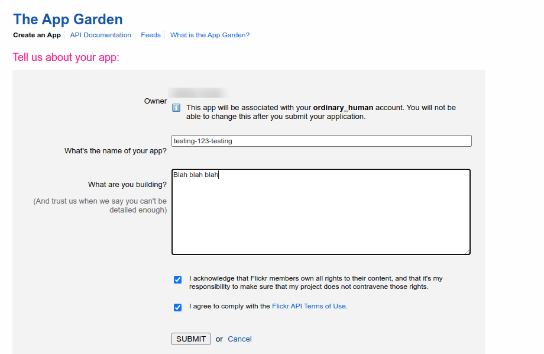

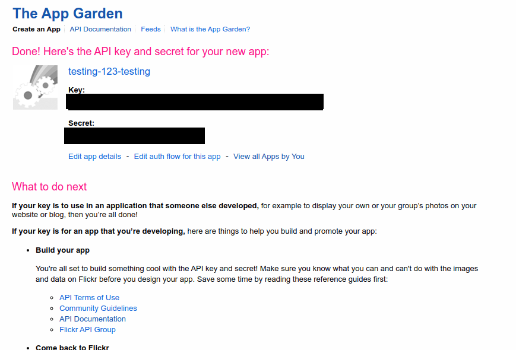

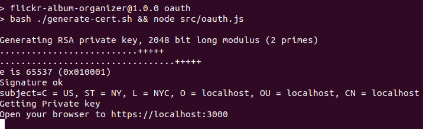

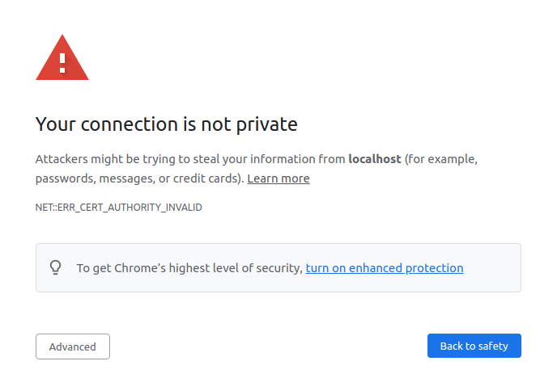

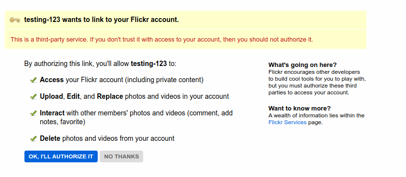

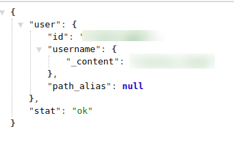

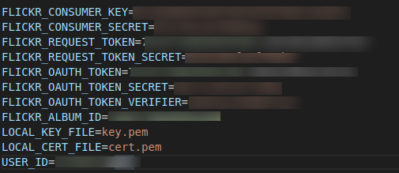

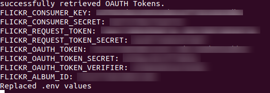

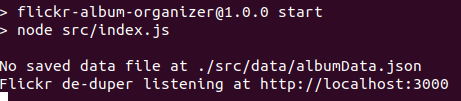

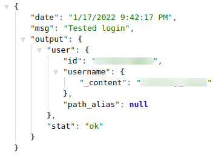

</details>

## Private Docker / NAS deployment — `.env` deliberately baked in

**This is the intended setup for the project.** You prepare `.env` locally with the credentials and then build a private image that already contains everything needed to talk to Flickr. **No Docker `--env-file`, secret volumes, remote secret manager, or startup credential injection is required.**

```bash
# From this repository's root, after creating a real .env:
docker build -t flickr-deduper:local .
docker run -d \
  --name flickr-deduper \
  --restart unless-stopped \
  -p 127.0.0.1:3000:3000 \
  -v flickr-deduper-data:/app/data \
  flickr-deduper:local
```

Or use Docker Compose:

```bash
docker compose up -d --build
docker compose logs -f
```

The Dockerfile intentionally executes `COPY .env ./.env`, and **`.dockerignore` intentionally allows `.env` into the build context**. Docker sets `HOST=0.0.0.0` and `DATA_DIR=/app/data`, so the API is reachable through the locally bound host port while the album snapshot and downloaded photos persist in the named volume.

**The `.env` file is ignored by Git, not by Docker.** It is not supplied in the repository ZIP; create it on the machine where you build the image. The resulting local image does contain the secrets, including in extractable filesystem layers. Keep images, build caches, machine access and backups private; do not push the image to a public registry. If credentials change, update `.env` and rebuild the image. If you accidentally publish an image, revoke the affected Flickr tokens and rebuild.

**Note:** `docker build` will intentionally fail without a local `.env`; this protects against accidentally producing a container that cannot authenticate.

## Everyday CLI operations

The CLI provides the most explicit and safest way to make changes. Run `npm run cli -- help` for the current command reference.

```bash
npm run cli -- refresh       # fetch every album page; save state
npm run cli -- duplicates    # inspect candidate groups (no deletion)
npm run cli -- sizes         # cache highest-resolution URLs
npm run cli -- backup        # download images into DATA_DIR/backup
npm run cli -- reorder --confirm YOUR_ALBUM_ID
npm run cli -- ugly --ids 123456,987654
npm run cli -- sync          # perform nightly workflow immediately
```

**Permanent deletion is manual by default.** After checking the candidate IDs, execute:

```bash
npm run cli -- dedupe \
  --confirm YOUR_ALBUM_ID \
  --allow-timestamp-only
```

This re-fetches the current album, determines candidates, waits for each Flickr deletion, and refreshes the saved snapshot. It favors the album's primary photo when there is a timestamp collision; otherwise it retains the earliest uploaded photo.

You can run the CLI from the already-built container without passing credentials:

```bash
docker exec flickr-deduper node src/cli.js duplicates
docker exec flickr-deduper node src/cli.js refresh
```

### Automated daily run

By default, the same container runs the HTTP server **and** a daily maintenance job at `03:00` in `America/New_York`. Configure:

```dotenv
AUTO_SYNC=true
SYNC_TIME=03:00
TZ=America/New_York
AUTO_REORDER=true
AUTO_DELETE=false
```

The daily workflow updates the photo list, caches image URLs, and reorders the album when enabled. To restore the old app's **automatic nightly permanent deletion**, consciously opt in with all three settings below in your local `.env`, then rebuild the image:

```dotenv
AUTO_DELETE=true
AUTO_DELETE_CONFIRM_ALBUM_ID=YOUR_ALBUM_ID
AUTO_DELETE_ALLOW_TIMESTAMP_ONLY=true
```

These separate settings prevent an incidental deployment from deleting photos just because the original app used a cron job. If you want only manual operations, set `AUTO_SYNC=false`.

## HTTP API

The HTTP interface is convenient for local automation. The Docker port is exposed on **127.0.0.1 only**, so it is not publicly accessible by default.

| Method and path | Result |
| --- | --- |
| `GET /` | Service status |
| `GET /test-login` | Test Flickr authentication |
| `GET /get-photosets` | List available Flickr albums |
| `GET /get-photos` | Fetch all pages and refresh snapshot |
| `GET /dedupe` or `GET /duplicates` | **Preview**, not delete, timestamp matches |
| `GET /info` | Return the cached album snapshot |
| `POST /dedupe` | Permanently delete confirmed candidate IDs |
| `POST /reorder` | Sort the album newest-first |
| `POST /get-sizes` | Cache largest available image URLs |
| `POST /download-photos` | Back up images to disk |
| `POST /save-data` | Save the current snapshot |
| `POST /ugly` | Flag photo IDs for manual review |
| `POST /sync` | Run maintenance immediately |

`POST` operations require an `ADMIN_TOKEN` value in `.env` and an `Authorization: Bearer ...` header; without it, they are disabled. This is separate from Flickr's OAuth tokens.

```bash
curl -s http://localhost:3000/duplicates
curl -s -X POST http://localhost:3000/ugly \
  -H "Authorization: Bearer YOUR_ADMIN_TOKEN" \
  -H 'Content-Type: application/json' \
  -d '{"photoIds":["123456","987654"]}'
```

For destructive deletion, `POST /dedupe` additionally requires body `{"confirmAlbumId":"YOUR_ALBUM_ID","allowTimestampOnly":true}`. A plain `GET /dedupe` can never delete anything. Unlike the old code, requests wait for Flickr to complete before responding.

## Data format and migration

The app saves a versioned JSON snapshot at `DATA_DIR/album.json`, with photo IDs, capture/upload dates, cached URLs, primary photo ID and the list of photos flagged as ugly. It uses atomic file replacement, so an interrupted write does not leave half-written JSON.

If you have an old `src/data/albumData.json`, **save a backup of it first**. Place it at its original path and launch from the repository root. The loader attempts a one-time migration when the new data file does not yet exist. Old URLs and ugly-photo marks are preserved. A fresh `refresh` adds the current Flickr metadata and primary photo. For Docker, do that migration on the host before building, or copy the migrated `data/album.json` into the persistent volume.

## Development and verification

```bash
npm ci                # no third-party runtime dependencies
npm run check         # syntax check + unit/integration tests
npm run test:coverage # Node built-in coverage
npm run dev           # Node watch mode
```

Tests use stubbed Flickr responses and temporary files. They cover OAuth signing against a reference vector, API requests, pagination (including one-page albums), duplicate planning, deletion confirmation, HTTP auth, persistence, scheduling, and backup behavior. **No live credentials are necessary or used by the test suite.** This is not a substitute for trying the app against your own Flickr account before enabling deletion.

The GitHub Actions workflow tests Node.js 22, 24 and 26. `.DS_Store`, `__MACOSX`, temporary `.env` files, generated certificates, and downloaded data are excluded from version control.

## Flickr API references

- [Flickr OAuth documentation](https://www.flickr.com/services/api/auth.oauth.html)
- [List photos in an album](https://www.flickr.com/services/api/flickr.photosets.getPhotos.html)
- [Edit a photoset's photo order](https://www.flickr.com/services/api/flickr.photosets.editPhotos.html)
- [Get photo sizes](https://www.flickr.com/services/api/flickr.photos.getSizes.html)
- [Flickr SDK](https://github.com/flickr/flickr-sdk), used by the original edition but no longer required

This is a personal, self-hosted tool; verify backups and review timestamp collisions before enabling automatic deletion.
